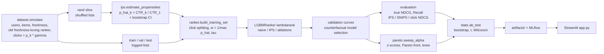

# Debiased Learning-to-Rank & Multi-Objective RecSys Engine

A short-video feed ranker trained on **position-biased, confounded click logs**. The project
estimates the position bias from a randomized traffic slice, trains an **IPS-weighted LambdaMART**
(LightGBM `lambdarank`) next to a naive one, evaluates both on hidden ground truth *and* with
**counterfactual IPS / SNIPS estimators** computed from logged clicks only, runs a **paired offline
A/B test** (bootstrap, t-test, Wilcoxon), and finally buys back content **freshness** in a controlled
way through a **relevance-vs-freshness Pareto front** with an automatically selected knee point under
a 2 % NDCG guard-rail. Everything runs from a synthetic simulator, so there is no download and every
estimate can be checked against the truth.

## Key results

`python train.py` (default mode: 30 000 sessions x 10 items, 300 boosting rounds, seed 42,
eta = 1, tau = 0.15; test split = 6 000 sessions). Ground-truth metrics use the simulator's hidden
graded relevance; `IPS`/`SNIPS`/`click` columns use only held-out logged clicks.

| policy (test) | NDCG@5 | NDCG@10 | Recall@5 | IPS-NDCG@5 | SNIPS-NDCG@5 | click-NDCG@5 | Freshness@5 |
|---|---|---|---|---|---|---|---|
| oracle (true relevance) | 1.000 | 1.000 | 0.990 | 1.537 | 0.622 | 0.723 | 0.425 |
| old logging policy | 0.655 | 0.771 | 0.785 | 1.166 | 0.471 | **0.759** | 0.563 |
| random | 0.429 | 0.635 | 0.509 | 0.759 | 0.311 | 0.318 | 0.421 |
| naive LambdaMART (clicks as labels) | 0.757 | 0.834 | 0.880 | 1.300 | 0.524 | 0.741 | 0.526 |
| **IPS LambdaMART** (pairwise IPS) | **0.798** | **0.862** | **0.905** | **1.334** | **0.539** | 0.712 | 0.454 |
| IPS + MOO re-ranking (alpha* = 0.19) | 0.783 | 0.851 | 0.894 | 1.315 | 0.530 | 0.726 | 0.498 |
| ablation: IPS weight on clicked rows only | 0.793 | 0.858 | 0.904 | 1.330 | 0.537 | 0.719 | 0.467 |
| ablation: IPS weight on every row | 0.762 | 0.836 | 0.886 | 1.296 | 0.523 | 0.737 | 0.515 |

| paired offline A/B (6 000 test sessions, 2 000 bootstrap resamples) | mean diff [95 % CI] | relative lift [95 % CI] | p (bootstrap / t / Wilcoxon) |
|---|---|---|---|
| NDCG@5: naive -> IPS | +0.0413 [+0.0379, +0.0447] | +5.45 % [+4.98, +5.92] | 0.001 / 8e-118 / 1e-133 |
| IPS-DCG@5 (logged clicks only): naive -> IPS | +0.0269 [+0.0142, +0.0407] | +3.00 % [+1.58, +4.52] | 0.001 / 9e-5 / 0.76 |
| NDCG@5: IPS -> IPS+MOO (price) | -0.0157 [-0.0178, -0.0136] | -1.97 % [-2.23, -1.71] | 0.001 / 2e-46 / 2e-61 |
| Freshness@5: IPS -> IPS+MOO (gain) | +0.0442 [+0.0426, +0.0458] | +9.74 % [+9.35, +10.11] | 0.001 / ~0 / ~0 |

Other facts from the same run:

* **Propensities** from 3 000 randomized sessions: max |p_hat_k - p_k| = 0.022, fitted
  eta_hat = 0.989 (true 1.0). The naive logged-CTR curve gives CTR_10/CTR_1 = 0.02 instead of
  p_10 = 0.10, because the old ranker also put better/fresher items on top.
* **The naive model over-trusts freshness**: share of LightGBM gain on `freshness` 0.21 (naive)
  vs 0.10 (IPS); Freshness@5 0.526 vs 0.454 (oracle: 0.425).
* **The naive offline metric is misleading**: click-NDCG@5 ranks the old logger first and prefers
  the naive model over the IPS model; IPS/SNIPS reverse both verdicts, in agreement with ground truth.
* **Weights really change LambdaMART**: a model trained with all weights = 1 is bit-identical to the
  unweighted model (max |score diff| = 0.0), while IPS weights change the top-5 set in 60.3 % of
  test sessions (Spearman of scores 0.937).
* **MOO knee** (chosen on validation): alpha* = 0.19, validation NDCG@5 drop 1.98 %, freshness +9.49 %;
  on test -1.97 % / +9.74 %. The unconstrained knee would be alpha = 0.48 (-14 % NDCG). Both the
  naive model and the old logger lie *below* the IPS+MOO front (dominated).
* Counterfactual model selection picked 280 / 150 / 120 / 180 trees for naive / IPS / clicked / row.

`python train.py --full` (120 000 sessions, 500 rounds): NDCG@5 naive 0.770 -> IPS 0.812
(+5.51 %, CI [+5.30 %, +5.71 %], 24 000 test sessions), IPS+MOO at alpha* = 0.18: -1.91 % NDCG@5, +9.29 % Freshness@5,
eta_hat = 1.001. Runtime ~3 min vs ~30-50 s for the default mode on a laptop CPU (i7-12700H).

## Architecture



## Method

**Click model (examination hypothesis).** $P(c=1 \mid k, d) = p_k\,\gamma(d)$ with
$p_k = k^{-\eta}$ and $\gamma(r) = \epsilon + (1-\epsilon)\frac{2^r - 1}{2^{4} - 1}$ for graded relevance
$r \in \{0..4\}$. The logging policy ranks by `relevance proxy + 2.5 * freshness + noise`, so
freshness is correlated with position (corr = -0.56) while barely related to relevance (corr = 0.03).

**Propensity estimation: result randomization.** On a 10 % slice the K shown items are uniformly
permuted, so the relevance distribution is identical at every position and
$\mathbb{E}[\mathrm{CTR}_k] = p_k\,\mathbb{E}[\gamma]$, hence $\hat p_k = \mathrm{CTR}_k / \mathrm{CTR}_1$
(convention $p_1 = 1$). CIs from a session bootstrap; $\hat\eta$ from a log-log least-squares fit.
*Why this method:* it relies on nothing but the examination hypothesis, every randomized session
informs all K positions (more data-efficient than RandPair swaps), and the estimator is trivially
testable. The price is a UX cost on the slice; EM / regression-EM or intervention harvesting avoid
it at the cost of model assumptions.

**Clipped IPS.** $w_i = 1/\max(\hat p_{k_i}, \tau)$, $\tau = 0.15$:
$\mathbb{E}[c_i w_i] = \gamma_i$ for $p_{k_i} \ge \tau$, while the clip caps the variance
($\mathrm{Var}(c/p) = \gamma/p - \gamma^2$) at the price of under-weighting positions with $p_k < \tau$.

**IPS LambdaMART in LightGBM.** LightGBM multiplies each row's lambda-gradient and hessian by its
`sample_weight`, but the unbiased pairwise objective
$L = \sum_{i \in C} \frac{1}{p_{k_i}} \sum_{j \notin C} \ell(s_i - s_j)$ needs a weight per *pair*,
set by the clicked item. **Click splitting** makes this exact: a session with $m$ clicks becomes $m$
pseudo-queries (one clicked row + all non-clicked rows), all rows weighted by the clicked item's
$w_i$. Ablations: weight only clicked rows (`clicked`), weight every row by its own position (`row`,
which amplifies the push-down of low-position non-clicked items). Rows are shuffled within each query
so that LightGBM's stable tie-breaking at iteration 0 cannot leak the logged position.

**Counterfactual evaluation.** For a re-ranking $\pi$ of a logged list,
$\mathrm{IPS\text{-}DCG@}k(\pi; s) = \sum_{i \in C_s} w_i\,\mathbb{1}[r_\pi(i) \le k] / \log_2(1 + r_\pi(i))$
is unbiased for DCG@k with gains $\gamma$. *IPS-NDCG@k* divides by the session's unit-gain click
IDCG and averages (Horvitz-Thompson style, can exceed 1); *SNIPS-NDCG@k* =
$\sum_s \mathrm{IPS\text{-}DCG}_s / \sum_s \mathrm{IPS\text{-}IDCG}_s \in [0, 1]$ (self-normalized,
scale-invariant, lower variance). *Counterfactual model selection*: the naive arm early-stops on
validation click-NDCG, IPS arms on validation SNIPS-NDCG; ground truth is never used for training or
selection.

**Metrics** (vectorized over padded `(sessions x max_len)` matrices, one `argsort`):
$\mathrm{DCG@}k = \sum_{r \le k} (2^{rel_r} - 1)/\log_2(r+1)$, NDCG = DCG / IDCG,
Recall@k with relevant := grade >= 3, Freshness@k = mean freshness of the top-k.

**Multi-objective re-ranking.** Within-session Z-scores
$z(x)_i = (x_i - \bar x_s)/\sigma_s(x)$ and
$\mathrm{Score_{MOO}} = (1-\alpha)\,z(\hat{rel}) + \alpha\,z(\mathrm{fresh})$, $\alpha \in [0, 1]$
(101 values). Non-dominated points form the Pareto front; the knee maximizes the distance to the
chord between the two extremes (axes min-max normalized), subject to a relative NDCG@5 drop
<= 2 % vs $\alpha = 0$. alpha* is selected on validation and reported on test.

**Offline A/B.** Paired per-session differences $d_s = b_s - a_s$: session bootstrap (2 000
resamples, percentile CIs for the mean difference and the relative lift
$\bar b/\bar a - 1$, percentile p-value), `scipy.stats.ttest_rel`, `scipy.stats.wilcoxon`
(zero differences dropped).

## Repository layout

```
doomscrolling-recsys/
  src/
    __init__.py
    dataset.py     synthetic clickstream simulator (position bias + freshness confounding)
    ips.py         propensities (randomization + bootstrap), clipped IPS, IPS/SNIPS/click NDCG
    metrics.py     vectorized grouped DCG / NDCG / Recall / top-k mean
    ranker.py      LGBMRanker(lambdarank) + naive / pair / clicked / row training sets
    pareto.py      within-session z-scores, MOO scores, alpha sweep, Pareto mask, knee
    stats.py       paired bootstrap, paired t-test, Wilcoxon -> ABTestResult
    pipeline.py    end-to-end orchestration -> PipelineResult
    artifacts.py   artifacts/ bundle save/load (+ matplotlib figures)
    tracking.py    fail-safe MLflow wrapper (sqlite store in the repo)
  tests/           43 pytest tests (math, invariants, pipeline, Streamlit smoke)
  train.py         CLI: --quick / default / --full, MLflow + artifacts/
  app.py           Streamlit + Plotly dashboard (5 tabs), cold-start demo mode
  requirements.txt
  pytest.ini
  README.md
```

`train.py` writes `artifacts/`: `metrics.json`, `model_comparison.csv`, `propensities.csv`,
`pareto.csv`, `pareto_val.csv`, `ab_test.json`, `ab_bootstrap.csv`, `curves.csv`,
`feature_importance.csv`, `inspector_sessions.csv`, `models/*_lgbm.txt`, `figures/*.png`.

## Quickstart

```bash
python -m venv .venv
.venv\Scripts\activate            # Windows  (source .venv/bin/activate on Linux/macOS)
pip install -r requirements.txt

python train.py                   # default run, ~30-50 s
python train.py --quick           # ~15-25 s smoke run
python train.py --full            # 120k sessions, ~3 min
python train.py --eta 1.5 --tau 0.1 --scheme clicked --no-mlflow   # variations

streamlit run app.py              # works before train.py too (in-memory demo)
pytest -q                         # 43 tests, ~30-60 s
mlflow ui --backend-store-uri sqlite:///mlflow.db                    # browse runs
```

Dashboard tabs: (1) CTR by position vs true examination curve vs estimated propensities and IPS
weights; (2) model comparison, feature importance, validation curves, weight sanity check;
(3) Pareto front with an alpha slider, knee point and 2 % guard-rail, naive/logger reference points;
(4) A/B test: bootstrap histogram with CI and the three p-values; (5) session inspector: one
session's ranking (logged / naive / IPS / IPS+MOO) and rank shifts after MOO re-ranking.

## Design decisions & trade-offs

* **Synthetic data instead of a public dataset.** Public LTR sets lack display positions and clicks;
  public click logs lack true propensities and relevance. A simulator gives ground truth for every
  claim and zero cold start. Absolute numbers depend on simulator knobs; the mechanisms do not.
* **Result randomization** for propensities (transparent, data-efficient, but a UX cost).
* **Click splitting** gives the exact pairwise IPS objective inside the stock LightGBM API; the naive
  per-row reading is kept as an ablation and is measurably worse.
* **tau = 0.15** clips positions 8-10 (true p_7 = 0.143 is also below tau; the estimate 0.151 sits right at it); lower tau = less bias, more variance.
* **Strong tree regularization** (15 leaves, 300 min samples per leaf, lr 0.03): IPS weights inflate
  gradient variance; greedier settings made the IPS model overfit within ~20 trees.
* **No ground truth in model selection**: early stopping by validation SNIPS-NDCG (IPS) or click-NDCG
  (naive), as it would be in production.
* **alpha* chosen on validation**, evaluated on test; Z-scores per session so alpha means the same
  thing in every session.
* **Vectorization**: padded matrices for metrics, one matrix product for the propensity bootstrap,
  chunked index matrices for the A/B bootstrap.
* **MLflow is optional at runtime**: every call is guarded; `artifacts/` is written first.

## Limitations

* Simulated world: position-based click model only (no cascade / trust bias / satisfaction), static
  item freshness, no feedback loop between the new ranker and future logs.
* Re-ranking of the logged top-K only: no item-selection bias (items never shown), no retrieval
  training.
* Propensities are global (not per device / context) and estimated once.
* The MOO guard-rail is enforced on validation; on test the drop is close to the 2 % boundary and
  the upper end of its CI slightly exceeds it (-2.23 %). A formal non-inferiority test or a safety
  margin would make the constraint stricter.
* Offline A/B on simulated sessions is not a substitute for an online experiment.

## References

* T. Joachims, A. Swaminathan, T. Schnabel. *Unbiased Learning-to-Rank with Biased Feedback.* WSDM 2017.
* X. Wang, M. Bendersky, D. Metzler, M. Najork. *Learning to Rank with Selection Bias in Personal Search.* SIGIR 2016.
* X. Wang, N. Golbandi, M. Bendersky, D. Metzler, M. Najork. *Position Bias Estimation for Unbiased Learning to Rank in Personal Search.* WSDM 2018.
* A. Agarwal, I. Zaitsev, X. Wang, C. Li, M. Najork, T. Joachims. *Estimating Position Bias without Intrusive Interventions.* WSDM 2019.
* Q. Ai, K. Bi, C. Luo, J. Guo, W. B. Croft. *Unbiased Learning to Rank with Unbiased Propensity Estimation.* SIGIR 2018.
* Z. Hu, Y. Wang, Q. Peng, H. Li. *Unbiased LambdaMART: An Unbiased Pairwise Learning-to-Rank Algorithm.* WWW 2019.
* N. Craswell, O. Zoeter, M. Taylor, B. Ramsey. *An Experimental Comparison of Click Position-Bias Models.* WSDM 2008.
* C. J. C. Burges. *From RankNet to LambdaRank to LambdaMART: An Overview.* Microsoft Research Tech. Report MSR-TR-2010-82, 2010.
* G. Ke et al. *LightGBM: A Highly Efficient Gradient Boosting Decision Tree.* NeurIPS 2017.
* K. Järvelin, J. Kekäläinen. *Cumulated Gain-Based Evaluation of IR Techniques.* ACM TOIS 2002.
* A. Swaminathan, T. Joachims. *The Self-Normalized Estimator for Counterfactual Learning.* NeurIPS 2015.
* E. L. Ionides. *Truncated Importance Sampling.* Journal of Computational and Graphical Statistics, 2008.
* V. Satopää, J. Albrecht, D. Irwin, B. Raghavan. *Finding a "Kneedle" in a Haystack: Detecting Knee Points in System Behavior.* ICDCS Workshops 2011.
* B. Efron, R. Tibshirani. *An Introduction to the Bootstrap.* Chapman & Hall, 1993.
* F. Wilcoxon. *Individual Comparisons by Ranking Methods.* Biometrics Bulletin, 1945.
